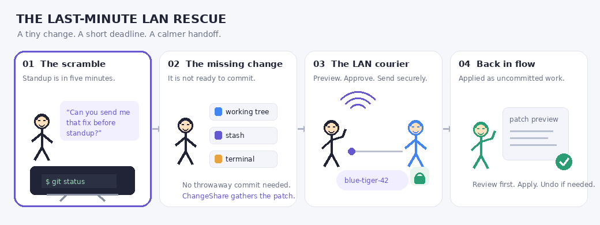
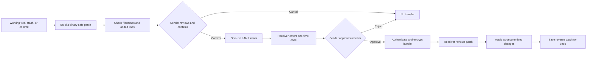

# ChangeShare

### Your change is ready. Your commit is not. Share the patch anyway.



**Share uncommitted Git changes directly between Linux computers on the same local network.** No throwaway commit, push, branch, or cloud account. The receiver reviews the patch before applying it and can undo it afterward.

## Get started

### Requirements

- Linux on both computers.
- Git 2.30 or later.
- Node.js 22 or later.
- A private LAN that allows the computers to connect to one another.
- `avahi-daemon` is recommended for automatic discovery. `--host` is the fallback.

### Install

Run this on both computers:

```sh
curl -fsSL https://raw.githubusercontent.com/AyushPandey510/changeshare/main/install.sh | bash
```

The installer downloads the Node.js CLI package and, when `code` or
`code-insiders` is on your `PATH`, the VS Code extension too. It requires
Node.js 22 or later and installs the `changeshare` command at
`~/.local/bin/changeshare`. If the installer updates your `PATH`, open a new
terminal as instructed.

### Send your first change

Open a terminal in each developer's copy of the Git project. Start the sender
first.

**Developer A:**

```sh
changeshare send
```

Review the file list and confirm. ChangeShare prints a one-time code, for
example `blue-tiger-42`. Keep the sender terminal open while your teammate
connects.

**Developer B:**

```sh
changeshare receive blue-tiger-42
```

Developer A approves the receiver. Developer B reviews the file list and
confirms the apply. The transferred changes appear as uncommitted edits.

<details>
<summary>What will I see?</summary>

The exact names and counts depend on your patch. A typical send looks like:

```text
2 file(s), +14 -3, 1.2 KB
  src/fix.ts
  README.md
No secrets found.
Send? [Y/n]
Share code: blue-tiger-42
Waiting for receiver at 192.168.1.12:8765 (expires in 10 min)...
```

The receiver sees who is connecting, the changed files, and an apply prompt.
Both people get a chance to stop the handoff before changes are applied.

</details>

<details>
<summary>Automatic discovery did not find the sender?</summary>

Use the sender's private or link-local IPv4 address:

```sh
changeshare receive blue-tiger-42 --host 192.168.1.12
```

The default port is `8765`. If the sender chose another port, pass it with
`--port` on this direct connection too.

</details>

## The last-minute LAN rescue

It is five minutes before standup. A fix is ready, but not ready for a commit.
The change is somewhere between the editor, terminal, and stash. Your teammate
needs it now. Instead of making a temporary commit or copying files by hand,
ChangeShare packages a reviewable patch and carries it directly over the LAN.

| The snag | The short route |
| --- | --- |
| The work is not committed yet. | Share working-tree edits, a stash, selected paths, or commit changes. |
| Staging area should stay untouched. | A temporary Git index builds the patch. |
| Need to check what is arriving. | Review the file list or preview the patch before applying. |
| The repositories are on different commits. | Check applicability and choose a three-way apply if needed. |
| Need to back out. | Run `changeshare undo` to reverse the latest transfer. |

## Follow the patch



This diagram is rendered by GitHub. The expandable sections in the guides below
hold the longer feature and troubleshooting details.

## What can I share?

| Source | Example |
| --- | --- |
| Current working tree | `changeshare send` |
| Selected paths | `changeshare send src/fix.ts README.md` |
| Latest or selected stash | `changeshare send --stash stash@{2}` |
| A commit's changes | `changeshare send --commit HEAD` |

All of these arrive as uncommitted edits. ChangeShare does not recreate the
sender's commit. For previews, conflict choices, undo, VS Code, and the full
command reference, see the [usage guide](docs/USAGE.md).

## Safety and limits, at a glance

- The patch is compressed and encrypted for transfer over the LAN. The sender
  approves each receiver; the receiver approves the apply.
- The default file denylist includes `.env*`, `*.pem`, `*.key`, and `id_rsa*`.
  Added patch lines are also scanned for common credential patterns.
- Secret scanning is heuristic. It can miss secrets or flag ordinary text;
  always review the files and patch yourself.
- `--include-ignored` also bypasses the filename denylist. Use it carefully.
- The released CLI and extension target Linux. There is no cloud service or
  telemetry. Some guest and corporate Wi-Fi networks block device-to-device
  connections.

Read the [security and privacy guide](docs/SECURITY.md) for what is sent, how
the session is protected, and the protocol's limits.

## When the LAN gets in the way

Run `changeshare doctor` for local Git, runtime, discovery, port, and firewall
checks. To test whether two computers can reach each other, run
`changeshare doctor --listen` on one and `changeshare doctor --peer <ip>` on the
other. The peer check uses port `8766`.

Common fixes:

- Discovery fails: pass the sender's LAN address with `--host`.
- Peer check fails: check client isolation and local firewall rules.
- Patch conflicts: use `--dry-run`, try three-way apply, or see the
  [conflict guide](docs/USAGE.md#when-a-patch-conflicts).
- VS Code list is stale: VS Code Git events refresh visible lists; a
  low-frequency fallback check runs only while the Stashes view is visible.
  See [the extension guide](vscode-extension/README.md).

More troubleshooting steps are in the [usage guide](docs/USAGE.md#troubleshooting).

## Explore or contribute

- [Full usage guide](docs/USAGE.md): every option, conflicts, undo, VS Code,
  diagnostics, and troubleshooting.
- [Security and privacy](docs/SECURITY.md): data flow, protections, and limits.
- [Architecture guide](docs/ARCHITECTURE.md): how the source code fits together.
- [VS Code extension guide](vscode-extension/README.md): use, develop, and
  package the extension.

To build from source, install Node.js 22 or later, then run `npm install`,
`npm run build`, and `node dist/cli.js --help` from the repository root.

### Publish a GitHub release

Update the extension version in `vscode-extension/package.json`, then push a
new, unused version tag. GitHub Actions packages the Node.js CLI and VSIX and
attaches them to a [GitHub Release](https://github.com/AyushPandey510/changeshare/releases).

```sh
git tag vX.Y.Z
git push origin vX.Y.Z
```

Replace `vX.Y.Z` with the version being released, then confirm the workflow
attached `changeshare-node.tar.gz`, `changeshare-vscode.vsix`, and `install.sh`.

---

Made for the moment when the fix is ready before the paperwork is. 🧑‍💻
